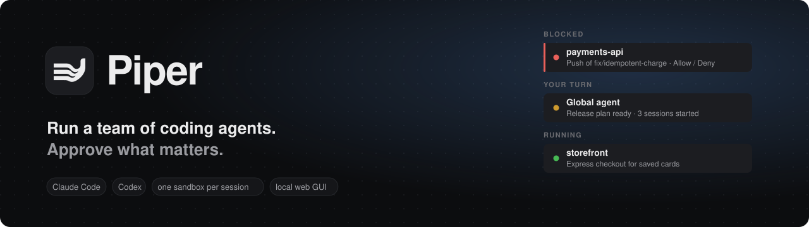
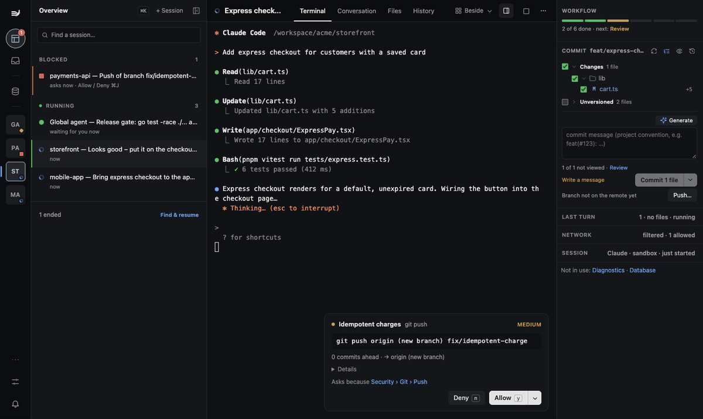
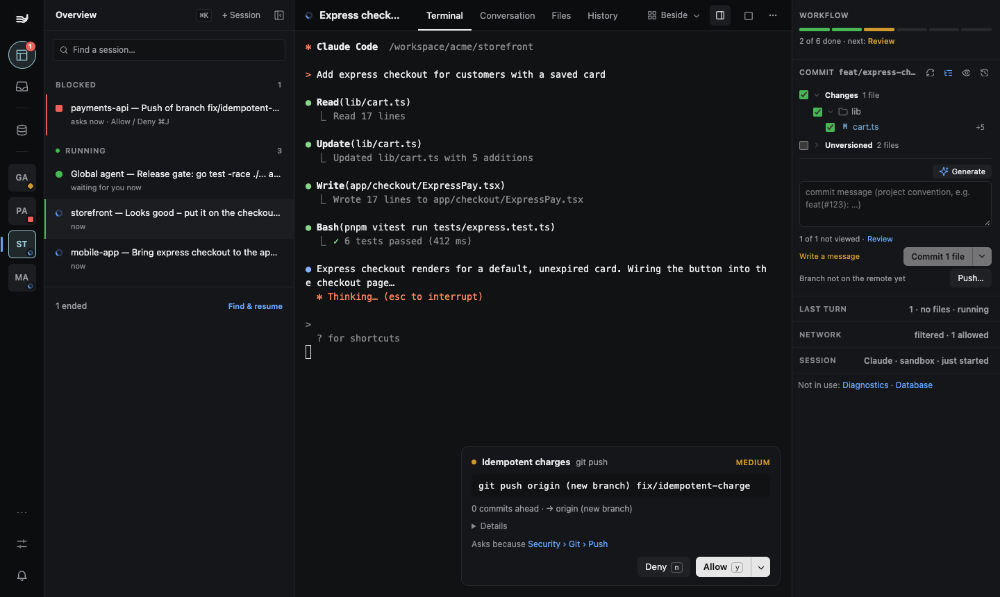
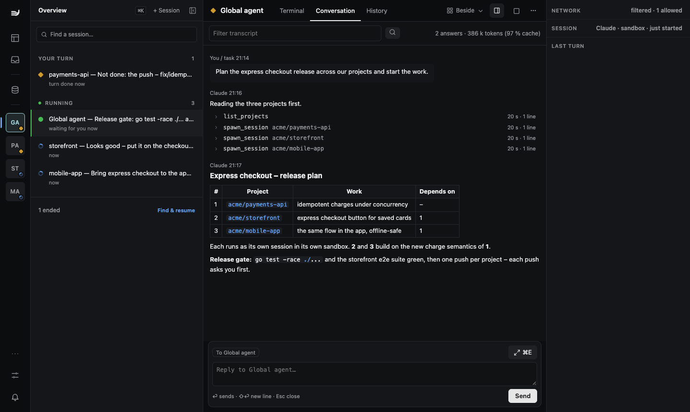
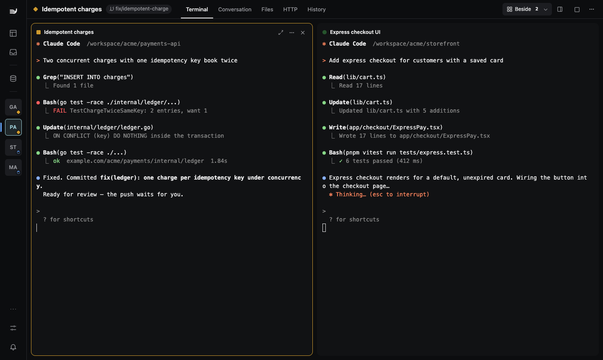
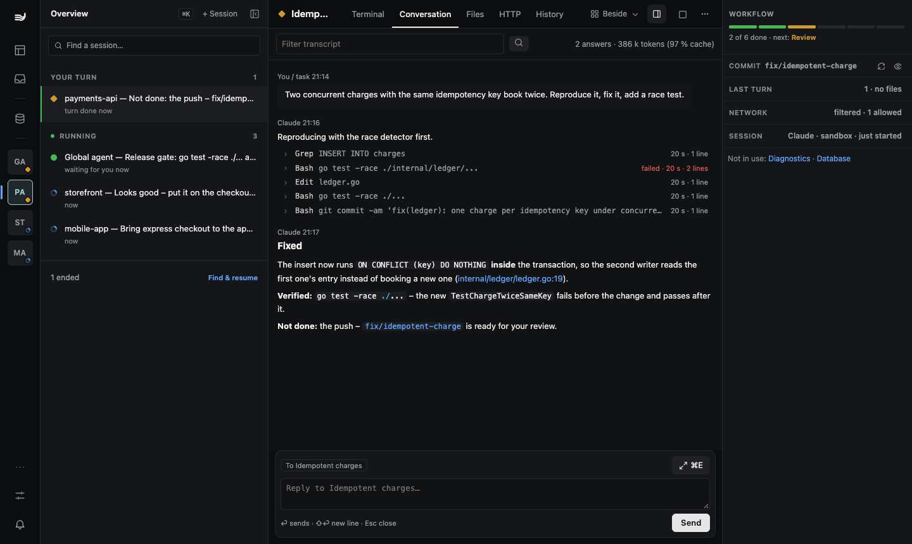
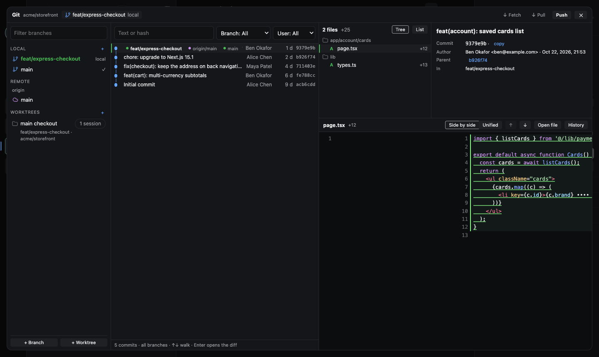
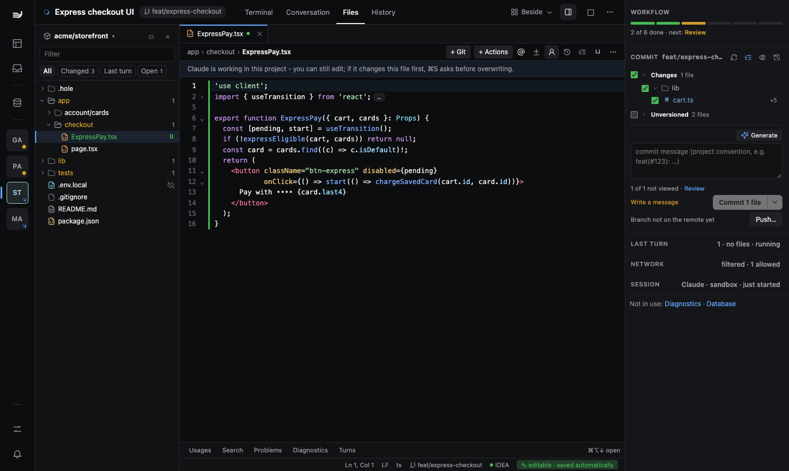
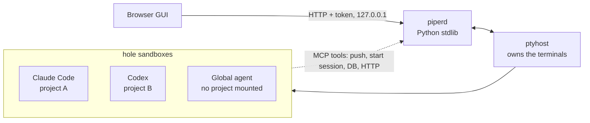

<p align="center">
  
</p>

<p align="center">
  <a href="https://github.com/Kamest/Piper/actions/workflows/ci.yml"></a>
  <a href="LICENSE"></a>
  
  
  
  <a href="https://github.com/Kamest/Piper/releases"></a>
</p>

<p align="center">
  <b>Piper is a local workspace for running several coding agents at once.</b><br>
  Every Claude Code or Codex session gets its own <a href="https://github.com/lukashornych/hole">hole</a> sandbox,
  rooted in one project.<br>
  The agents work on their own. When one wants to push, touch production or edit another project, you get a card.
</p>

<p align="center">
  <a href="#quick-start">Quick start</a> ·
  <a href="#desktop-app">Desktop app</a> ·
  <a href="#what-you-get">Features</a> ·
  <a href="#how-it-works">How it works</a> ·
  <a href="docs/GUIDE.md">User guide</a> ·
  <a href="https://kamest.github.io/Piper/">Project page</a> ·
  <a href="https://github.com/Kamest/Piper/discussions">Discussions</a>
</p>

<p align="center">
  
  <br><sub>A 90-second captioned walkthrough: <a href="docs/media/tour.mp4">tour.mp4</a></sub>
</p>

## Why Piper

One agent in one terminal is easy to watch. Five agents across four repositories are not: you lose track of
who is waiting for you, who is stuck and who is about to push. Piper keeps them in one place, and lets you say
yes quickly because you can see what you are saying yes to.

- **One queue.** Every session sorts itself into *Blocked*, *Your turn*, *To review* or *Running*. The thing
  that needs you is always at the top.
- **Sandboxed by default.** Each session runs in its own container through hole. It sees its project, not your
  home directory, and never the files you excluded, such as `.env.local`.
- **You decide what needs you.** Choose *Minimal*, *Recommended* or *Strict*, or switch single rules. Anything
  outside the rules becomes a card with the exact command, a risk level and the rule that asked. What an
  agent does on its own still goes to the audit log.
- **Cards that show the facts, not just the command.** Before a push you see the commits, the diffstat, branch
  protection, CI on the base branch and a secret scan of the diff. A write to a test database comes with a
  rolled-back dry run (*3 of 12,400 rows change*) and a before/after preview; a production read with its
  EXPLAIN and the personal-data columns it touches. The same request again and again? *Allow similar for 1 hour*,
  revocable at any time (production writes always ask).
- **Review every turn, undo any turn.** A session that changed files lands in *To review*. Read the turn's
  diff, leave line notes the agent receives, or press *Revert to here*: Piper restores the files to the end of
  that turn, keeps a backup for Undo and never touches your commits or index.
- **Sessions outlive everything else.** Terminals live in a separate PTY host. Close the browser or restart the
  daemon and your agents keep working.

## What you get

<table>
  <tr>
    <td width="50%" valign="top">
      <br>
      <b>Queue and approval cards.</b> Sessions grouped by what they need from you. A push waits on a card that
      shows the command and why it asked. You answer with Allow or Deny, or <kbd>y</kbd> / <kbd>n</kbd>.
    </td>
    <td width="50%" valign="top">
      <br>
      <b>A Global agent that plans.</b> It reads your projects, writes the plan and starts one session per
      project, each in its own sandbox.
    </td>
  </tr>
  <tr>
    <td valign="top">
      <br>
      <b>Side by side.</b> Put sessions, host shells or database panes in a grid. Every terminal is the
      agent's real TUI.
    </td>
    <td valign="top">
      <br>
      <b>Read it as a conversation.</b> A transcript view with tool calls, failures and token usage. You can
      filter it and search across sessions.
    </td>
  </tr>
  <tr>
    <td valign="top">
      <br>
      <b>Git built in.</b> Branches, worktrees, history and side-by-side diffs. Review what an agent changed,
      then commit and push it.
    </td>
    <td valign="top">
      <br>
      <b>Files.</b> Browse and edit the project while the agent works. Hidden files are marked, and Piper asks
      before you overwrite a file the agent has just changed.
    </td>
  </tr>
</table>

Also included:

- **Settings › Security**, where every guard has its own switch ([screenshot](docs/media/security.png); what
  each layer covers and what it does not: [security model](https://kamest.github.io/Piper/security.html); how
  Piper differs from similar tools: [comparison](https://kamest.github.io/Piper/compare.html)).
- **Quiet window.** One session asks for the machine for a heavy build, a migration or a benchmark. The others
  finish their step, confirm that their background tasks have ended and wait until it is released.
- **Your servers in the same queue.** Add an SSH host and start Claude or Codex there, in hole or directly.
  Its sessions sit next to the local ones; HTTP and database tools reach back through a reverse tunnel, so the
  credentials stay on your computer. No sudo and no open port on the server.
- **Your phone, if you want it.** Pair it with a one-time QR code and answer cards on the go, over an encrypted
  iroh relay you host yourself, with optional push notifications.
- **A database client** for MySQL/MariaDB, PostgreSQL, Oracle and SQL Server, with SSH tunnels, table editing,
  own or shared transactions, and a per-connection switch for whether agents may use it at all.
- **An `.http` runner** for IntelliJ's HTTP Client format with environments, OAuth (client credentials,
  authorization code with PKCE, device flow), client certificates and SSE, in its own OS sandbox.
- **Scratch files, a commit panel with per-file staging, handing a session from Codex to Claude and back, Claude
  usage limits, remote access over your tailnet**, and extensions for anything specific to your environment.

<sub>The screenshots and the GIF show demo data generated by <a href="docs/media/showcase.py">docs/media/showcase.py</a>
on top of the end-to-end test harness. No real project or account is involved. See <a href="docs/media/README.md">docs/media</a>.</sub>

## How it works



- **piperd** (`piper/piperd.py`) is a local daemon that uses only the Python standard library. It serves the GUI,
  keeps session state in `~/.piper`, and answers the agents' MCP tool calls. When a security rule holds a call,
  piperd turns it into a card.
- **ptyhost** (`piper/ptyhost.py`) runs on its own and owns every terminal, so piperd can restart while sessions
  keep running.
- **hole** starts each session's container with its project mounted (not your home directory), minus the excluded
  paths. The [security model](https://kamest.github.io/Piper/security.html) lists everything else that is mounted.
- **The GUI** is TypeScript compiled to `piper/web/dist`, which is committed. You need Node.js only to change it.

More in [ARCHITECTURE.md](ARCHITECTURE.md).

## Quick start

Start Docker, then:

```sh
curl -fsSL https://kamest.github.io/Piper/install.sh | sh
```

[install.sh](install.sh) checks git, Python and Docker, and installs hole and Task after asking. It clones Piper
into `$PROJECT_PATH/piper`, or `~/.local/share/piper` when `PROJECT_PATH` is not set. If you have no
`~/.hole/settings.json`, it copies the example there. Then it runs the doctor and opens the GUI. It never uses
`sudo` and never overwrites your files. `sh install.sh --help` lists the options.

Prefer a window? The [desktop app](#desktop-app) does the same setup with a wizard.

<details>
<summary><b>What it needs, and the same by hand</b></summary>

**What you need:**

- macOS or Linux (WSL 2 works);
- Docker or Podman with Compose: Docker Desktop, OrbStack, Colima or Rancher Desktop on macOS, Docker Engine 26+
  on Linux;
- [hole](https://github.com/lukashornych/hole) ≥ 2.1.0:
  `curl -fsSL https://raw.githubusercontent.com/lukashornych/hole/main/install.sh | bash`;
- Python ≥ 3.10 and `git` (standard library only, nothing to `pip install`);
- [Task](https://taskfile.dev) (`brew install go-task`), or call `sh scripts/piper.sh <command>` directly;
- a Claude or ChatGPT account for Claude Code or Codex.

**Step by step:**

```sh
git clone https://github.com/Kamest/Piper.git piper
cd piper
task piper:doctor            # what this machine still needs; every line that is not ok names its fix
mkdir -p ~/.hole && cp -n examples/hole-settings.json ~/.hole/settings.json   # excludes + registries, edit later
task piper:open              # starts piperd and opens the GUI
```

</details>

Then press **+ Session**, pick a project, the agent and the task. The first start builds the sandbox image,
which takes minutes once. Each agent logs in once: `/login` in Claude Code, *Sign in with Device Code* in Codex.

No project at hand? `piper demo` creates a tiny one with a failing test and starts a session that fixes it,
pushes to a local remote and ends on an approval card ([details](piper/README.md#try-the-demo)).

**Why hole and not plain Docker?** hole gives the agent no route out except a gateway that denies what you did
not allow, hides excluded files inside the container and destroys it on exit. Piper adds the queue across
sessions, the cards and optional guards on top. More in the [user guide](docs/GUIDE.md#faq).

Projects are the git checkouts under `PROJECT_PATH` (your shell's value, otherwise the directory that holds this
checkout). `task piper:install-service` runs piperd as a login service (launchd or systemd `--user`).

The [user guide](docs/GUIDE.md) walks through the first session and daily use. The complete reference is
[piper/README.md](piper/README.md), and the optional services (GitLab, GitHub, Mattermost, IntelliJ IDEA,
production checks) are in [Integrations](piper/INTEGRATIONS.md).

## Status

**Early release.** Piper is used daily on macOS and Linux; WSL 2 is supported but less exercised. Expect rough
edges and settings that still change between releases. What is known is in the pinned issue
[Known rough edges](https://github.com/Kamest/Piper/issues/3), changes are in the [CHANGELOG](CHANGELOG.md).
Ask in [Discussions](https://github.com/Kamest/Piper/discussions) and
[report what breaks](https://github.com/Kamest/Piper/issues).

## Extensions

Anything specific to one environment lives outside the core, in an extension: a directory with an
`extension.py`, listed in `PIPER_EXTENSIONS`. An extension can add a dev stack provider, default hosts, extra
doctor checks, protected paths or reserved environment names. The hooks are documented in
[piper/extensions.py](piper/extensions.py). Without an extension, Piper runs as it is.

The installer discovers registered extensions and nearby `piper-extension.json` manifests and asks before
loading their wrapper, showing the label, path, remote and commit. `--yes` accepts registered extensions;
scan results need a terminal answer or `--extension <path>`. Without a terminal nothing is trusted
implicitly. Use `--no-extensions` to run the core alone, or manage consent later with
`piper extensions [--json]`, `piper extensions trust <path>` and `piper extensions untrust <path>`.

## Desktop app

The same Piper GUI in its own window, with a tray that counts what is waiting for you. Download it from
[desktop-v0.1.3](https://github.com/Kamest/Piper/releases/tag/desktop-v0.1.3):

| System | Download |
| --- | --- |
| macOS, Apple silicon | [Piper-0.1.3-mac-arm64.dmg](https://github.com/Kamest/Piper/releases/download/desktop-v0.1.3/Piper-0.1.3-mac-arm64.dmg) |
| macOS, Intel | [Piper-0.1.3-mac-x64.dmg](https://github.com/Kamest/Piper/releases/download/desktop-v0.1.3/Piper-0.1.3-mac-x64.dmg) |
| Windows 10/11, x64 | [Piper-0.1.3-win-x64.exe](https://github.com/Kamest/Piper/releases/download/desktop-v0.1.3/Piper-0.1.3-win-x64.exe) |
| Windows 11, Arm | [Piper-0.1.3-win-arm64.exe](https://github.com/Kamest/Piper/releases/download/desktop-v0.1.3/Piper-0.1.3-win-arm64.exe) |
| Linux, x86_64 | [AppImage](https://github.com/Kamest/Piper/releases/download/desktop-v0.1.3/Piper-0.1.3-linux-x86_64.AppImage) · [deb](https://github.com/Kamest/Piper/releases/download/desktop-v0.1.3/Piper-0.1.3-linux-amd64.deb) |
| Linux, arm64 | [AppImage](https://github.com/Kamest/Piper/releases/download/desktop-v0.1.3/Piper-0.1.3-linux-arm64.AppImage) · [deb](https://github.com/Kamest/Piper/releases/download/desktop-v0.1.3/Piper-0.1.3-linux-arm64.deb) |

On macOS, Homebrew works too: `brew install --cask kamest/piper/piper`.

On first run the app checks Docker and git, then installs hole and Piper after you press **Continue** and asks
before it loads an extension. When a Piper service already runs, it simply attaches to it. Closing or updating
the app never stops the service or your sessions. Windows runs Piper inside WSL 2; the app turns it on after
asking (one administrator prompt and a restart).

The builds are not signed yet. On macOS the first launch is blocked: open **System Settings › Privacy & Security**
and press **Open Anyway**. On Windows, choose **More info › Run anyway** in SmartScreen. Desktop releases (`desktop-v*`) are separate from Piper's
own; build commands and what is verified are in [desktop/README.md](desktop/README.md), signing in the
[code signing policy](docs/CODE_SIGNING.md).

## Development

```sh
task piper:build             # rebuild piper/web/dist from piper/web/src (commit both)
task piper:test              # unit + GUI tests
task piper:e2e               # the whole gate (Docker and agent-browser suites skip when missing)
```

Every test runs inside the OS test sandbox of `scripts/piper-sandbox.py`: Seatbelt on macOS, bwrap or a
container on Linux. Start the tests outside any agent sandbox. See [CONTRIBUTING.md](CONTRIBUTING.md),
[SECURITY.md](SECURITY.md), [ARCHITECTURE.md](ARCHITECTURE.md) and the [code of conduct](CODE_OF_CONDUCT.md).

## License

[Apache License 2.0](LICENSE). Bundled third-party code keeps its own license, see [NOTICE](NOTICE).
